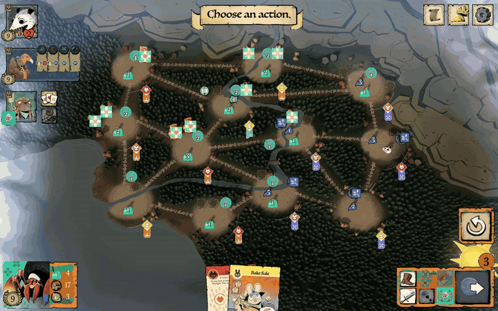
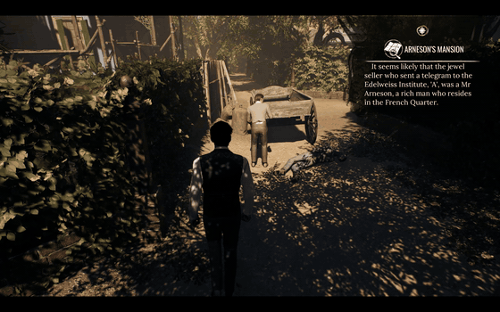
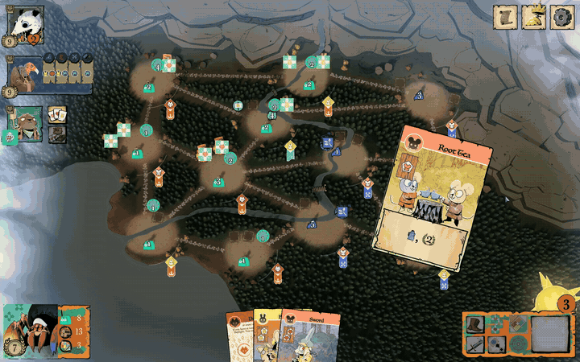
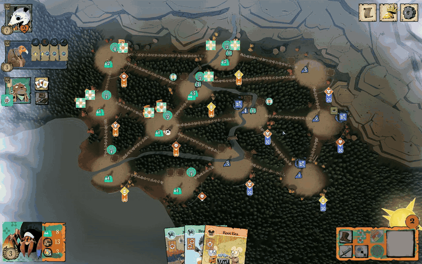
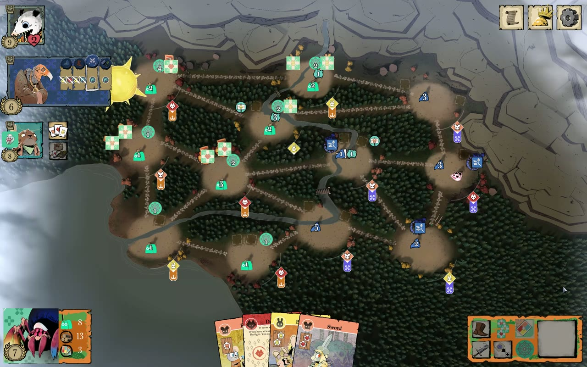
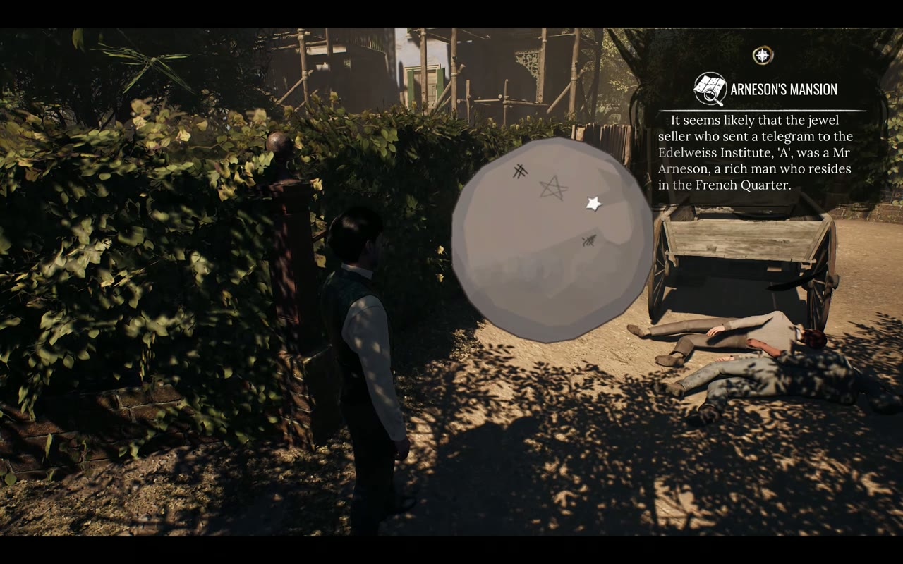

<div align="center">

# The Reversal Engine (RET)

**A method and a toolkit for taking a shipped game apart, safely, and putting something new inside it.**

Two finished mods, built with RET on Linux (Proton), from no source code at all:
a **new playable faction in *Root*** and **Root's Vagabond striking NPCs inside *Sherlock Holmes: The Awakened***.

<br>

<a href="media/root-spinners-match-part1.mp4"></a>
<a href="media/sherlock-vagabond-strike.mp4"></a>

<sub>Click a preview for the video: a complete 19-minute Root match (two parts), and the Sherlock mod in play.</sub>

</div>

---

## What RET is

RET is two things stacked on top of each other:

1. **A toolkit** (`src/`): reads a game's files and says what it is built with, what protects it, and whether it is
   safe to touch (`ret recon`); records every file before a change and proves afterwards what changed (`ret snapshot`,
   `ret diff`); reads Unity IL2CPP metadata, Unity animation data and Unreal IoStore containers; inspects the
   assemblies a mod loader generates (`interop-inspect`).
2. **A method** ([docs/method.md](docs/method.md)): how to go from "I want X in this game" to a working mod without
   guessing your way through dozens of crashes. Read before you write, trace how the game does a thing and imitate it,
   one hypothesis per test run, stop after three identical failures, and keep every change reversible.

The two mods below are the evidence that the method works on very different engines.

## Mod 1: Spinners of Mercy, a new faction in *Root* (Unity IL2CPP)

<table>
<tr>
<td width="33%"><br><sub><b>Recruit</b>: a warrior and a web in every matching clearing along the web track</sub></td>
<td width="33%"><br><sub><b>Skitter</b>: any number of moves, but only along your own webs</sub></td>
<td width="33%"><br><sub><b>Shelter</b>: discard matching cards at infirmaries to score</sub></td>
</tr>
</table>

*Spinners of Mercy* is a **fan-made** Root faction (see [Credits](#credits)). Root ships with a closed list of
factions compiled to native code, so adding one means teaching the game's rules engine a faction it has never heard of.
RET does it with a BepInEx 6 plugin (`src/agents/root-bepinex/SpinnersOfMercy/Plugin.cs`) that:

- plays Spinners **on top of an existing faction's class** (a "mask"), because the game's screen crashes on an
  unknown faction number, then replaces that faction's rules, piece by piece, for the Spinners player only;
- re-wires the host's buttons into Spinners actions: **Gather, Recruit, Establish, Skitter, Shelter**;
- gives Spinners its own setup (last, opposite an enemy home), **24 webs** made with the game's own piece factory,
  the fan board's scoring rules and Evening draw, and a fan-board viewer in the match (F9);
- was balanced against real matches: one version won in 8 turns and was cut back; see
  [the design write-up](docs/root-spinners-of-mercy.md#balance-what-we-changed-and-why).

**Result of the recorded match (plugin 0.32.0):** Spinners finished **second with 27 VP** against three AI factions
(Eyrie 32, Riverfolk 20, Vagabond 20). 16 Shelters scored 26 VP; 7 Recruits, 11 Establishes, 0 plugin errors, no crash.
Watch the full match: [part 1](media/root-spinners-match-part1.mp4) (setup to mid-game) · [part 2](media/root-spinners-match-part2.mp4) (to the final scores) ·
[How it was built](docs/root-spinners-of-mercy.md)

<p align="center"><br>
<sub>The fan faction's board, readable inside the match (F9), so the player knows what each re-wired button does.</sub></p>

## Mod 2: Root's Vagabond in *Sherlock Holmes: The Awakened* (Unreal Engine 4)

<p align="center"></p>

A cross-game port: Root's **Ball of Violence** fight cloud and the Vagabond's leap, rebuilt from Root's own particle
settings and textures (re-simulated in Python, no Unity or Unreal editor), shown inside Sherlock Holmes with a UE4SS
Lua mod. The struck NPC falls under Sherlock's own ragdoll physics, Root's sounds play through a small companion
process, and **F10** stands everyone back up. The first experiment in the same game is a **2× time-dilation** probe
(F9 / F8). [Watch it](media/sherlock-vagabond-strike.mp4) · [How it was built](docs/sherlock-vagabond.md)

## The method in one screen

| Rule | Why it exists (each one cost real test runs) |
|---|---|
| **Recon first, and respect the verdict** | `ret recon` returns go / caution / **stop**. Anti-cheat present = stop, nothing is attached. DRM is never stripped or bypassed. Online games stay offline while modded. |
| **Snapshot before, diff after** | Every install is reversible; `undeploy.sh` removes exactly the files `deploy.sh` added. |
| **Read, don't guess** | Check every method signature before patching it. One wrong target once disabled a whole patch class. |
| **Trace, then imitate** | Log how the game does a thing itself (how its own Move picks a piece, how its own Birdsong advances the turn), then copy that shape. |
| **One hypothesis per test** | Two changes in one run make a failure unreadable. |
| **Circuit breaker** | Three failures of the same kind = stop patching, go back to reading. This is what finally fixed the Evening loop and the Recruit button. |
| **Evidence, not claims** | Every test run is logged with what was assumed; the final match was recorded with a timeline and a manifest (plugin version, sha256, event counts, errors). |

Full write-up: [docs/method.md](docs/method.md) · Step by step: [docs/using-ret.md](docs/using-ret.md) · The hard lessons, bug by bug: [docs/bug-journal.md](docs/bug-journal.md)

## Use it on your own project

The workflow above is written up as a step-by-step guide: recon and the go / caution / stop verdict, snapshots, choosing
a loader (BepInEx for Unity, UE4SS for Unreal), reading before writing, trace-then-imitate, testing like an experiment,
and recording the result. It is not game-specific: the same loop works for understanding or extending any program you
own. **[docs/using-ret.md](docs/using-ret.md)**

> **Responsible use.** RET is for software you own, offline: single-player mods, learning, interoperability,
> preservation. Not for cheating in online games, bypassing DRM or anti-cheat, piracy, or anything that harms others;
> recon refuses anti-cheat games on purpose. You are responsible for how you use it. **[RESPONSIBLE_USE.md](RESPONSIBLE_USE.md)**

## Quick start (toolkit)

```bash
python3.11 -m venv .venv
.venv/bin/pip install -r requirements.txt            # UnityPy, only needed for the Root extraction experiments
.venv/bin/python src/main.py recon <game folder>      # read-only fingerprint + go / caution / stop
.venv/bin/python src/main.py snapshot <game folder>   # record every file before a change
.venv/bin/python src/main.py diff <game folder> <snapshot.json>
.venv/bin/python -m unittest discover -s tests        # format tests use synthetic files; golden tests skip without the games
```

Output goes to `~/ret-work/<game>/`, never into the repository. Installing the mods themselves is described in each
write-up; you need your own copies of the games.

## Repository layout

```
src/main.py                         CLI: recon, snapshot, diff, assets, companion
src/core/                           recon (fingerprint + verdict), snapshot/diff, sound companion
src/utils/                          one reader per format: PE, Unity, IL2CPP metadata v31, Mecanim, Unreal, IoStore, Steam
src/tools/interop-inspect/          C# tool: signatures of the assemblies BepInEx generates
src/agents/root-bepinex/            Spinners of Mercy plugin, BepInEx install/uninstall, HUD art cutter, match recorder
src/agents/sherlock-ue4ss/          RetVagabond Lua mod
experiments/                        Root effect/character extraction and re-simulation; s1_probe = the speed probe
docs/                               method, using RET, the two mods, bug journal
media/                              videos, previews, stills
```

## Credits

- **Spinners of Mercy** is a fan faction for Root: original idea by **Elionor Gustafsson**, implemented and developed
  by **Per Holmgren**, art by **Kyle Ferrin** reworked by **Per Holmgren** (faction board v8.5, as published in the
  Tabletop Simulator "Root - Ultimate Collection"). The Spinners art seen in the videos and stills is their work. This
  project only ports their faction into the digital game, for the Root community, non-commercially. **No fan art is
  included in this repository**: `make_hud_art.py` cuts it from the user's own copy of the fan files, and the plugin loads it from there. If the
  creators would like their art or footage of it removed, please
  [open an issue](../../issues) on this repository (or use the contact on the owner's GitHub profile) and it will be
  removed.
- ***Root*** is by **Leder Games**; the digital edition by **Dire Wolf**. ***Sherlock Holmes: The Awakened*** is by
  **Frogwares**. RET is not affiliated with or endorsed by any of them. No game files, extracted assets or generated
  interop assemblies are distributed here; every mod needs the user's own legally owned copy, played offline.
- Built on **[BepInEx](https://github.com/BepInEx/BepInEx)** 6 (bleeding edge be.788), **HarmonyX**,
  **Il2CppInterop**, **[UE4SS](https://github.com/UE4SS-RE/RE-UE4SS)** 3.0.1, **[UnityPy](https://github.com/K0lb3/UnityPy)**,
  and **gpu-screen-recorder** for the evidence recordings.

## License

Code: MIT ([LICENSE](LICENSE)). The license covers the code in this repository only, not the games, the fan faction
or any art shown in the media.
