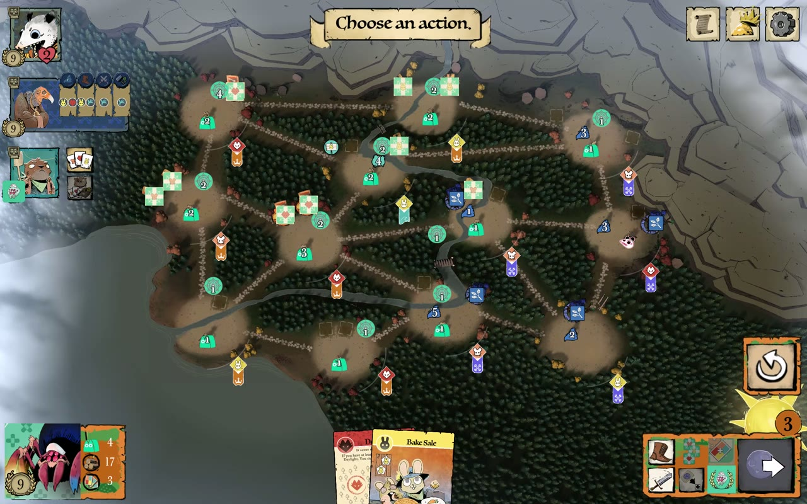

# Spinners of Mercy in digital *Root*

*Spinners of Mercy* is a fan-made faction for the board game *Root* (idea: Elionor Gustafsson; developed by Per
Holmgren; art: Kyle Ferrin, reworked by Per Holmgren). They are nurses: they spin a web across the woodland, build
infirmaries, and score by sheltering patients. This document is how RET put that faction into the **digital** game,
which has no mod support and compiles its rules to native code.

Plugin: `src/agents/root-bepinex/SpinnersOfMercy/Plugin.cs` (BepInEx 6.0.0-be.788, HarmonyX, Il2CppInterop, .NET 6).
Final version: **0.32.0**.

## 1. How Root builds a faction (found by reading, then tracing)

Root is a Unity IL2CPP game (Unity 2022.3, metadata v31). RET's metadata reader lists every type and method; the
loader generates C# stubs to call them. Reading and tracing showed:

- **A faction is its player class.** `MarquiseDeCatPlayer : TuberPlayerEntity` overrides `initialize`, the setup
  actions, the Birdsong / Daylight / Evening actions, and the battle, removal and crafting hooks. Every player starts
  as the same empty areas; `initialize` fills them and stamps the faction.
- **Pieces are plain entities with attributes.** A wood token is an entity named `Wood` in the player's token area with
  `PieceType=Token`, `TokenType=Wood`, `Faction=MarquiseDeCat`. Abilities (March, Build, Recruit…) are entities too.
- **A faction's identity has four layers:** its number (on the player and on every piece), its player class, its
  archetype ID, and the client's art and HUD looked up by that number. A missing row in any table keyed by faction
  number means "nothing".
- **The rules engine is a stack of actions** (`Move`, `Draw`, `GainVP`, `ChainedAction`, prompts…). Children run with
  their parent's context; the stack is **serialized at every player prompt**, so anything left on it must be
  serializable.

## 2. The mask

Giving Spinners its own faction number worked in the rules engine but crashed the client's player HUD (it has no
layout for an unknown number). So Spinners is built as a **mask**: it runs on the Marquise de Cat class and keeps
Marquise's faction number, so the screen loads normally. The plugin records which player is Spinners and changes
behaviour **only for that player**. A real Marquise is made mutually exclusive with Spinners in the lobby, so the two
never share a game.

In the lobby, Spinners appears as its own faction in the Solo Play selector. In the match, the plugin swaps the
Marquise HUD art for Spinners art (portrait, warriors, webs, infirmaries, buttons), cut from the fan board by
`make_hud_art.py` on the player's machine, and opens the full fan board inside the match with **F9** (F10 flips it).

## 3. Mechanics: fan rule → where it hooks into Root

| Fan board rule | Implementation | How |
|---|---|---|
| **Setup (N)**: last, in the corner opposite an enemy home; 2 warriors + 2 webs + 1 infirmary, then 1 warrior + 1 web next door | works | own setup actions built from Root's `Move`; setup slot 140 (letter N) so Spinners goes after every official faction |
| **Pieces**: 20 warriors, 9 infirmaries (3 per suit), 24 webs | works | infirmaries = the host's three building tracks (mouse / rabbit / fox); webs = wood tokens, the 16 missing ones made with Root's own `createPiece` |
| **Gather**: once per turn, draw a card | works | the host's Recruit button (the client sends no click for it, Gather needs none) |
| **Recruit**: once per turn, discard a card → a warrior and a web in each matching clearing | works | the host's Overwork button (it carries a clearing click); the clicked clearing's suit is recruited |
| **Establish**: discard a card → an infirmary in a matching clearing with a web | works | the host's Build button |
| **Skitter**: any number of moves between clearings connected by web, ignoring rule | works | the host's March: its move step repeats while you keep moving; destinations replaced by the web track |
| **Shelter** (Evening): once per infirmary, discard a matching card → score the track's VP | works | opens at the end of Root's own Daylight loop, on the Overwork button; scores with Root's `GainVP` |
| **Evening draw**: one card per card icon showing | works | `AdditionalDraws` answers (icons − 1) on top of Root's base draw |
| **Webs**: a removed web scores its remover one point less | works | removal VP for webs taken off Root's own payment |
| Daylight: 3 actions, +1 per bird spent | works | the host's own rule, unchanged |
| Crafting at infirmaries | partly | the host crafts with its workshops, which are the rabbit infirmaries; mouse and fox infirmaries do not craft yet |
| Intervene, First Response, the Ward, Triage, Discharge, Secure | **not built** (by choice, see below) | the host's battle stays; Birdsong does nothing for Spinners |

## 4. Balance: what we changed and why

The rules were the player's to decide. These are the decisions, in the order they were made, each from a real test.

**"Connected by web" = a train track.** The fan board does not say whether "connected" means a path of webbed
clearings or just two webbed ends. Answer: a **path**, "like a train track, you can't hop to another place when
there's an empty space", because otherwise Spinners moves anywhere "like a mole". Applied to:
- **Skitter**: each move goes from a webbed clearing to a neighbouring webbed clearing along an open path. Riding the
  track several steps is allowed (Skitter repeats); a gap stops you.
- **Placing webs**: a web can only go into a clearing that already has a Spinners web, or that is joined to one by
  an open path ("the web near the place must be travelable, not just near"). Blocked paths do not count.

**Recruit stays faithful.** The board says "each matching clearing". A version that placed in **every** clearing of
the suit across the map was too strong; with the train-track limit it places only on or next to the track. A
"click one clearing only" house rule was offered and declined: "if it's faithful to the board it's fine, the train
limitation helps it not be overpowered". Warriors and webs always come in pairs (a lone warrior with no web was a
complaint), and a bird card counts as the clicked suit only, never all three.

**The player chooses.** An interim build picked Recruit's suit automatically. It was rejected at once: an automatic
choice "ruins one's own strategy". The fix was moving Recruit to a button that carries the player's click.

**Card income.** With 24 webs and the host faction's card draw, Spinners **won a match in 8 turns**: 15 Shelters for 30
VP. The cause was card income: every Shelter costs a card, and the host's Evening draw handed out free cards. The fan
board says Spinners draws **only one card per card icon showing** (none before the infirmaries are out), and that
rule was put in.

**No more VP sources.** The Ward and Discharge (1 VP per released patient) would add a second scoring engine; they
were left out on purpose to avoid making the faction stronger again.

**Result:** in the recorded match after these changes, Spinners came **second with 27 VP** behind the Eyrie (32), ahead of
the Riverfolk and Vagabond (20 each). In an earlier match against more aggressive opponents it lost heavily (27 pieces
destroyed in 6 turns). That is the honest state: playable, close to the fan board, and weakest exactly where its
missing defensive rules (First Response, the Ward) would protect it.

## 5. The hard parts (details in the [bug journal](bug-journal.md))

- The **Evening ran twice** every turn for five builds; Root asks every faction for its Evening twice.
- **Recruit's clicks never arrived**: the client confirms that button with an empty selection.
- **Pieces made by hand crashed `Move`**; pieces made with Root's `createPiece` work.
- **Skipping the host's Birdsong looped the turn forever** (the game ended itself); that action also advances the turn.
  Only its wood placement is filtered now.
- **Comparing game objects** by their C# wrappers always failed; compare the native pointer.

## 6. Installing (your own copy of Root; offline only)

1. Download BepInEx `BepInEx-Unity.IL2CPP-win-x64-6.0.0-be.788+5b766a3.zip` (builds.bepinex.dev, project bepinex_be,
   build 788) and unpack it where `src/agents/root-bepinex/deploy.sh` expects it; the script checks its sha256.
2. Run `deploy.sh`, set Root's Steam launch option to `WINEDLLOVERRIDES="winhttp=n,b" %command%`, launch once (the
   first start generates the interop assemblies), quit.
3. Get the Spinners of Mercy fan files (Tabletop Simulator "Root - Ultimate Collection") and cut the HUD art with
   `make_hud_art.py`.
4. `install_plugin.sh` builds and installs the plugin. Pick **Spinners of Mercy** for a human seat in Solo Play.
5. Play **offline**, and don't save the game while testing. `undeploy.sh` removes exactly what was installed.

Recording a match as evidence: `record_match.sh` (screen via gpu-screen-recorder, choose the whole screen; Ctrl+C to
stop) writes the video, a timeline of every plugin event and a manifest.
